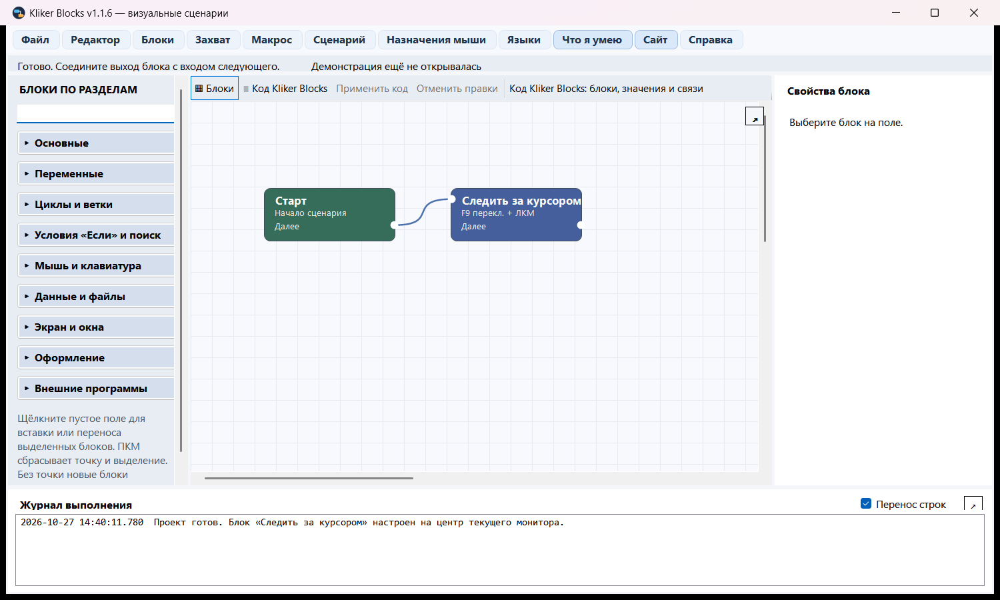
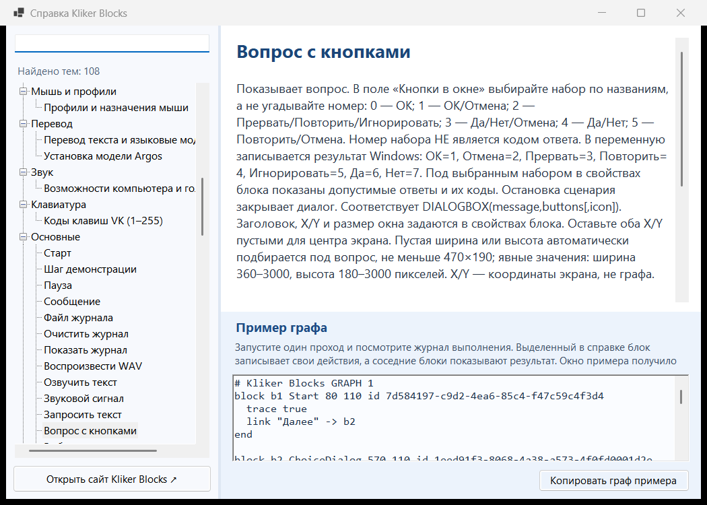
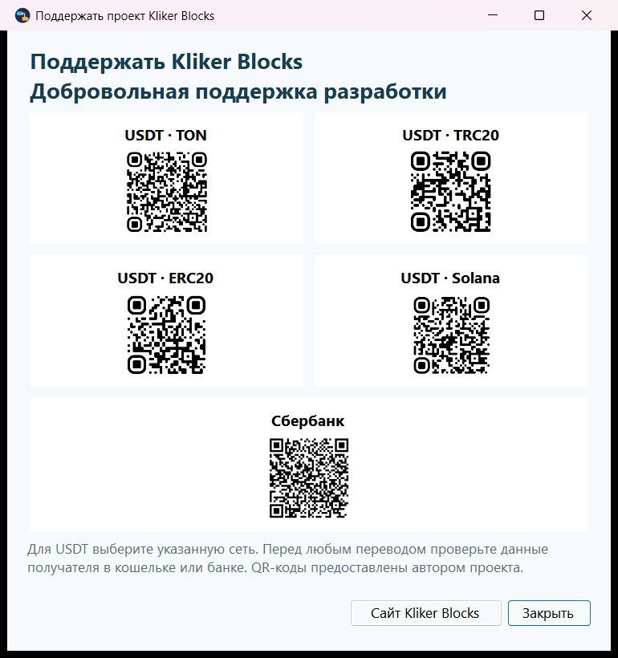

# Kliker Blocks

**Сайт:** https://malyshrush.github.io/kliker-blocks-site/ · **Скачать выпуск:** https://github.com/Malyshrush/kliker-blocks/releases/latest · **Вопросы и графы:** https://github.com/Malyshrush/kliker-blocks-site/discussions

Kliker Blocks 1.1.6 — публичная бета визуального редактора сценариев для Windows. При первом запуске, до редактора и демонстрации, выберите английский или русский язык. Выбор сохраняется; сменить язык позже можно в меню «Языки».

## Установка

В папке выпуска есть переносимая сборка и один файл `KlikerBlocks-Setup-1.1.6.exe`. Установщик сам выбирает английский или русский язык интерфейса по языку Windows. Можно выбрать папку, значок на рабочем столе, автозапуск и запуск после установки. Автозапуск также переключается в меню «Сценарий → Запускать вместе с Windows». Закрепление на панели задач выполняется через меню Windows у значка работающей программы: установщик не может сделать это автоматически без действия пользователя.

В журнале основного и отдельного окна «Перенос строк» меняет только отображение длинных записей. Справка показывает копируемый код графа в отдельной панели. Смешанный текст с вычислениями задаётся как `=[($counter+2)*3]& па \&`: при `counter=1` результат — `9 па &`.

Условие внутри вычисления: `=[if (${counter}+2)*3<10 then "Правда" else_if 35>25 then 22 else 33]`. Можно повторять `else_if`; `else` необязателен. `=[if $counter<10]` возвращает `TRUE` или `FALSE`. Чтобы одновременно вывести результат и сохранить его, пишите `=[if $counter<10 then "мало" else "много"] => ${xxx}& следующий текст`. Переменная `xxx` создаётся при необходимости; невыбранные ветки не вычисляются. Имена переменных подчиняются правилу A–Z, a–z, 0–9 и `_`.

В блоке «Выбрать вариант» нажимайте Enter между вариантами. В коде Kliker Blocks они находятся в одной строке `value "Options"`, где настоящий перенос показан как `\n`; редактор нормализует Windows `\r\n` до `\n`. Запись `\&` в свойствах означает буквальный знак `&` после вычисления шаблона, поэтому код графа показывает её как `\\&`: обратная косая черта экранируется ещё раз для строкового значения кода.

Блоки «Запросить текст», «Вопрос с кнопками» и «Выбрать вариант» позволяют задать заголовок окна, его экранные координаты X/Y, ширину и высоту. Оставьте оба X и Y пустыми для размещения по центру экрана; заполните оба поля для точной позиции. Пустые размеры автоматически подбираются под содержимое. Явная ширина: 360–3000 пикселей. Явная высота: 185–3000 для ввода, 180–3000 для вопроса с кнопками и 260–3000 для выбора варианта. Координаты блока на графе к положению диалогового окна отношения не имеют.

## Редактор и запуск

- Соединяйте блоки на поле или редактируйте тот же граф через переключатель «Код Kliker Blocks».
- Щёлкните ЛКМ по пустому полю: зелёная точка покажет место вставки следующего блока. Если блоки выделены, этот щелчок перенесёт их в точку с сохранением расстояний. ПКМ по пустому полю снимает выделение и убирает точку. Если точки нет, новые блоки размещаются по очереди.
- Значок стрелки в редакторе открывает граф в отдельном окне; значок стрелки у журнала открывает в отдельном окне тот же живой журнал.
- Запускайте, ставьте на паузу и останавливайте сценарий из редактора, компактной панели или трея. Доступны один проход и повторение до остановки.
- Встроенная справка содержит разделы, поиск, описание каждого блока и копируемый граф примера для режима «Код Kliker Blocks». Перед применением примера сохраните свой проект: код заменит текущий граф.
- Демонстрация «Что я умею» использует собственный документ Блокнота, рисует в Paint и показывает анализ цвета. Текст и речь следуют выбранному языку интерфейса. Действия с рабочим столом начинаются только после согласия пользователя. Она не требует машинного перевода.

## Файлы и внешние программы

Блок «Запустить файл» принимает абсолютный или относительный путь. Кнопка выбора показывает установленные программы из меню «Пуск» и системного каталога; также можно открыть любой существующий файл через Проводник. Аргументы, ожидание и таймаут задаются в свойствах блока. Ярлык `.lnk` может не возвращать процесс для ожидания.

## Перевод

Блоки перевода остаются в редакторе, но базовая сборка не содержит Python и языковых моделей. Для сетевого перевода нужен отдельно запущенный сервис LibreTranslate. Офлайн-перевод можно установить для выбранной языковой пары через меню «Языки» после подтверждения загрузки. Направление перевода важно; для обратного направления может потребоваться отдельная модель.

## Поддержать проект

Поддержка добровольна. В меню программы «Поддержать проект» и [на сайте](https://malyshrush.github.io/kliker-blocks-site/#support) размещены предоставленные автором пять QR-кодов: USDT для сетей TON, TRC20, ERC20 и Solana, а также Сбербанк. Перед переводом проверьте сеть и данные получателя, считанные из QR-кода.

## Данные и безопасность

Имена пользовательских переменных и массивов: латинские буквы, цифры и `_`, первый символ — буква или `_`. Примеры: `user_name`, `count_2`. При работе с окнами и файлами сначала сохраните свои данные. Kliker Blocks не удаляет пользовательские сценарии при выпуске новой версии.

## Проверки

Перед публикацией выполняются сборка, `--self-test`, `--localization-audit` и практические проверки доступных Windows-интеграций. Каждый выпуск размещается в отдельной папке `publish-vNN`.

## English

Kliker Blocks 1.1.6 is a public beta visual scenario editor for Windows. Connect blocks for logic, input, desktop control, files, screenshots, speech and logging, or edit the same graph as code. The interface and built-in Help are available in English and Russian. Each block has a copyable example graph.

Download the [latest installer or portable build](https://github.com/Malyshrush/kliker-blocks/releases/latest). Read the [website and searchable block catalog](https://malyshrush.github.io/kliker-blocks-site/), or join the [community discussions](https://github.com/Malyshrush/kliker-blocks-site/discussions) for help, bug reports, ideas and shared graphs.

Translation blocks are optional: the lightweight build does not bundle Python or language models. Configure an external service or install selected offline language pairs after confirmation. See the built-in Help before sending text to a service.

Supporting the project is voluntary. The app and [website](https://malyshrush.github.io/kliker-blocks-site/#support) show five author-supplied QR codes: USDT on TON, TRC20, ERC20 and Solana, plus Sberbank. Verify the network and recipient details decoded from a QR before sending.
